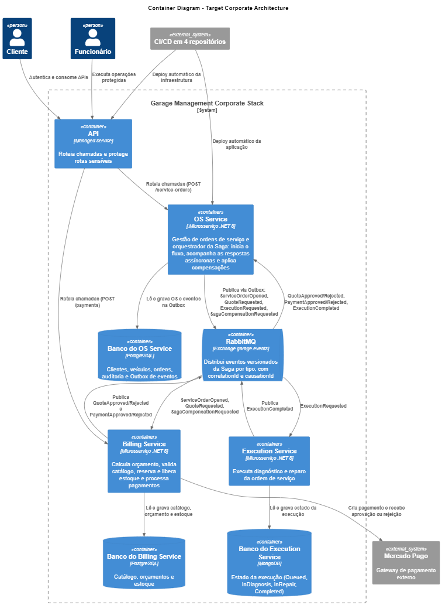

# Resumo implementação - Fase 4 - Tech Challenge

Este documento resume a implementação realizada para entrega dos requisitos da Fase 4 do Tech Challenge. 

## Estrutura dos Microsserviços

| Serviço | Responsabilidade | Banco Privado | Repositório Reservado |
| --- | --- | --- | --- |
| `os-service` | abertura, status e histórico da OS | PostgreSQL | |
| `billing-service` | orçamento, aprovação e pagamento | PostgreSQL | |
| `execution-service` | fila, diagnóstico, reparo e conclusão | MongoDB | |

Cada serviço possui seu próprio repositório, imagem, pipeline e namespace lógico.
Nenhum serviço recebe credenciais ou connection strings de outro banco. A integração ocorre somente por APIs e eventos versionados.

## Comunicação

- REST síncrono é usado apenas para comandos que precisam de resposta imediata (cadastros de clientes, veículos, serviços, entre outros).
- RabbitMQ é usado para eventos de domínio e comandos assíncronos (execução e criação da ordem de serviço, envio para pagamento, envio para diagnóstico, finalização da OS).
- Eventos possuem `eventId`, `correlationId`, `causationId` e `occurredAt` para idempotência, rastreabilidade e diagnóstico distribuído.
- O `os-service` persiste `ServiceOrderOpened` e `QuoteRequested` na Outbox PostgreSQL e o publicador faz retry até confirmar a publicação no RabbitMQ.

## Saga `Orquestrada`

O `os-service` é o dono da Saga `OpenServiceOrderSaga`:

1. Persiste a OS como `PendingBilling` e grava `ServiceOrderOpened` na Outbox.
2. Solicita a criação do orçamento ao `billing-service`.
3. Após `QuoteApproved`, aguarda o pagamento.
4. Após `PaymentApproved`, chama o `execution-service`.
5. Após `ExecutionCompleted`, atualiza a OS para `Finished`.

Falhas não são mascaradas. O estado da Saga fica persistido e pode ser retomado com segurança. As compensações são:

| Falha | Compensação |
| --- | --- |
| orçamento não criado | cancelar a OS como `BillingFailed` |
| pagamento rejeitado | marca a OS como `Canceled` e o orçamento como `PaymentRejected` e cancela reserva |
| pagamento estornado | cancelar a reserva e a OS como `PaymentReversed` |
| execução rejeitada | solicitar cancelamento do orçamento e marcar `ExecutionFailed` |

`PaymentRejected` dispara a compensação do orçamento via
`POST /quotes/{serviceOrderId}/compensate`. A operação é idempotente por
`compensated_at`, libera reservas de estoque uma única vez e então marca a OS como `Canceled`. 

Falhas ao criar a execução também compensam o orçamento antes
de cancelar a OS; o evento só é confirmado depois dessa compensação.

As transições carregam `correlationId` e `serviceOrderId`. A Outbox evita a
duplicação dos eventos de origem; os consumidores devem manter a deduplicação
por `eventId` ao evoluir para múltiplas réplicas.

## Fluxo de Execução da Saga Pattern 

Este documento descreve o fluxo distribuído completo entre o **OS Service**,
**Billing Service** e **Execution Service**. O OS Service atua como
orquestrador da Saga: inicia o processo, acompanha as respostas assíncronas e
aplica as compensações quando uma etapa falha.
- [Acessar Documento Completo](./saga-service-order-flow.md)

## Container Diagram

---