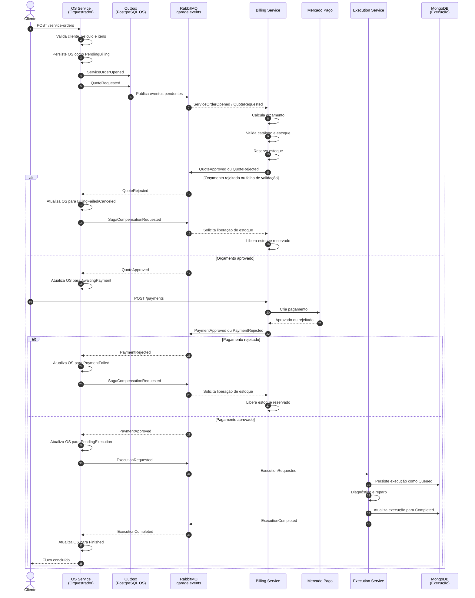
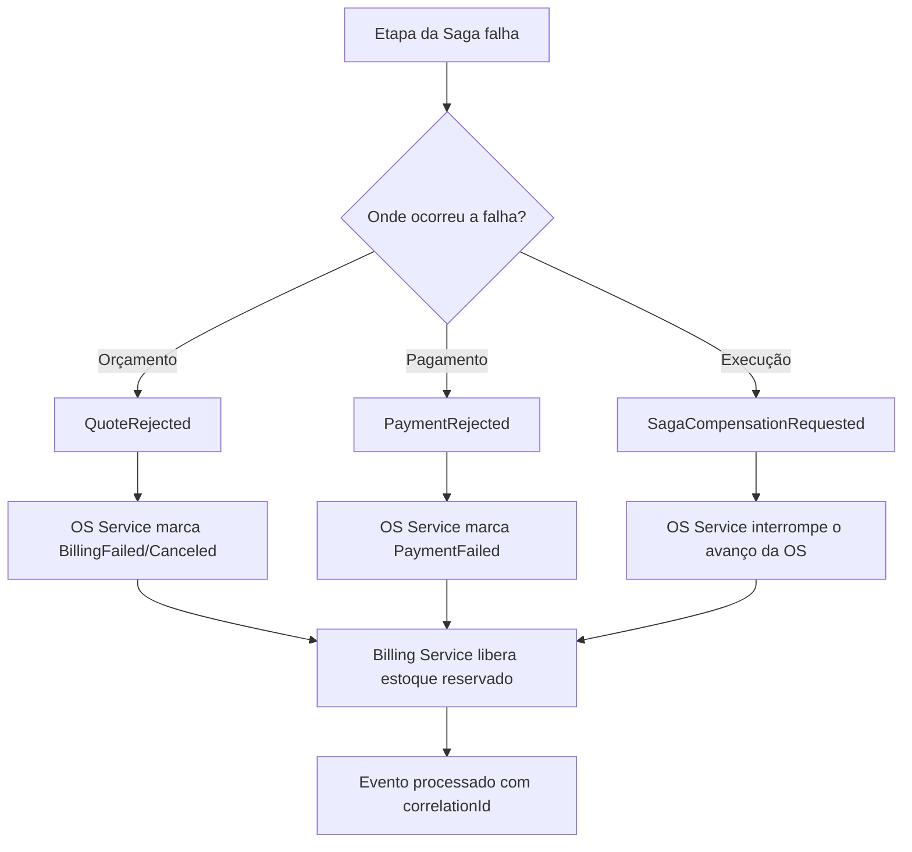
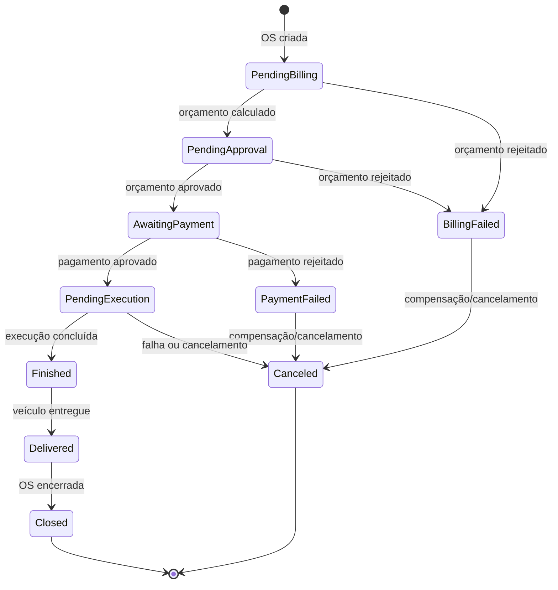

# Saga de ordem de serviço

Este documento descreve o fluxo distribuído completo entre o **OS Service**,
**Billing Service** e **Execution Service**. O OS Service atua como
orquestrador da Saga: inicia o processo, acompanha as respostas assíncronas e
aplica as compensações quando uma etapa falha.

## Visão geral

## Fluxo resumido por etapa

| Etapa | Serviço responsável | Ação | Evento principal |
|---|---|---|---|
| 1 | OS Service | Valida cliente, veículo e itens e cria a OS | `ServiceOrderOpened` |
| 2 | OS Service | Solicita a formação do orçamento | `QuoteRequested` |
| 3 | Billing Service | Calcula o valor, valida catálogo e reserva estoque | `QuoteApproved` ou `QuoteRejected` |
| 4 | Billing Service | Processa o pagamento externo | `PaymentApproved` ou `PaymentRejected` |
| 5 | OS Service | Solicita o início da execução após pagamento aprovado | `ExecutionRequested` |
| 6 | Execution Service | Executa diagnóstico e reparo | `ExecutionCompleted` |
| 7 | OS Service | Finaliza o ciclo da ordem de serviço | atualização para `Finished` |

## Fluxo de sucesso

```mermaid
flowchart LR
    A[Cliente abre OS] --> B[OS Service]
    B --> C[ServiceOrderOpened]
    C --> D[Billing Service]
    D --> E[Calcula orçamento]
    E --> F[Reserva estoque]
    F --> G[QuoteApproved]
    G --> H[Pagamento]
    H --> I[PaymentApproved]
    I --> J[ExecutionRequested]
    J --> K[Execution Service]
    K --> L[Queued]
    L --> M[InDiagnosis]
    M --> N[InRepair]
    N --> O[Completed]
    O --> P[ExecutionCompleted]
    P --> Q[OS Service: Finished]
```

## Fluxo de compensação

Uma Saga não desfaz uma transação distribuída com rollback global. Cada serviço
desfaz somente o efeito local que já confirmou.

## Envelope dos eventos

Todos os eventos devem usar o schema versionado
[`events/service-order-events.v1.json`](../events/service-order-events.v1.json)
e carregar, no mínimo:

- `eventId`: identificador único do evento;
- `eventType`: tipo da transição;
- `eventVersion`: versão do contrato;
- `correlationId`: identificador comum de toda a Saga;
- `causationId`: evento ou comando que causou a mensagem atual;
- `occurredAt`: instante UTC da publicação;
- `serviceOrderId`: ordem de serviço relacionada;
- `payload`: dados específicos do evento.

O `correlationId` permite acompanhar a Saga ponta a ponta nos logs, traces e
mensagens RabbitMQ. O `causationId` permite reconstruir a sequência causal
quando há retries ou compensações.

## Persistência e confiabilidade

- O OS Service grava eventos de saída na Outbox antes de confirmar a operação
  local.
- Um publicador da Outbox envia as mensagens pendentes para a exchange
  `garage.events`.
- O RabbitMQ distribui os eventos por tipo para os serviços interessados.
- O Billing Service mantém catálogo, orçamento e estoque no PostgreSQL próprio.
- O Execution Service mantém o estado da execução no MongoDB próprio.
- Falhas de uma etapa devem gerar evento de rejeição ou compensação, nunca uma
  confirmação falsa.
- Consumidores devem ser idempotentes usando `eventId` antes de confirmar a
  mensagem.

## Estados funcionais esperados

